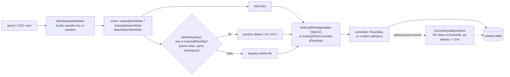
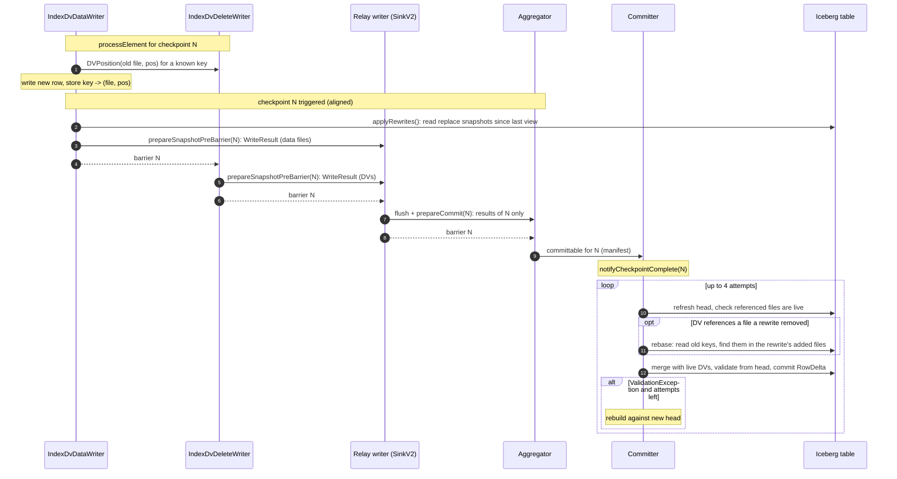
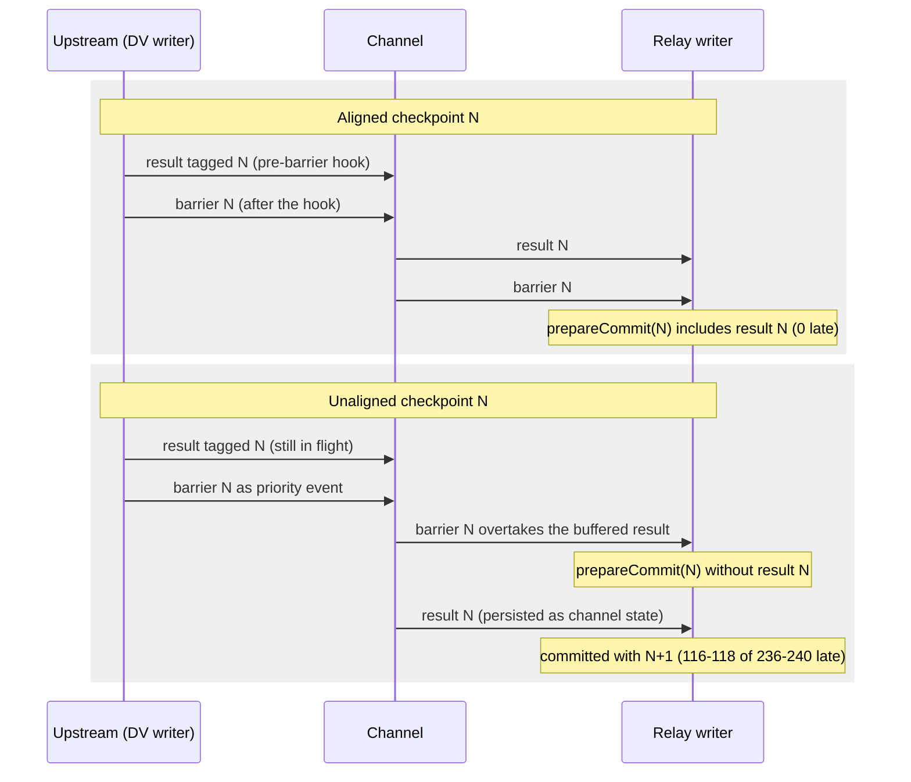
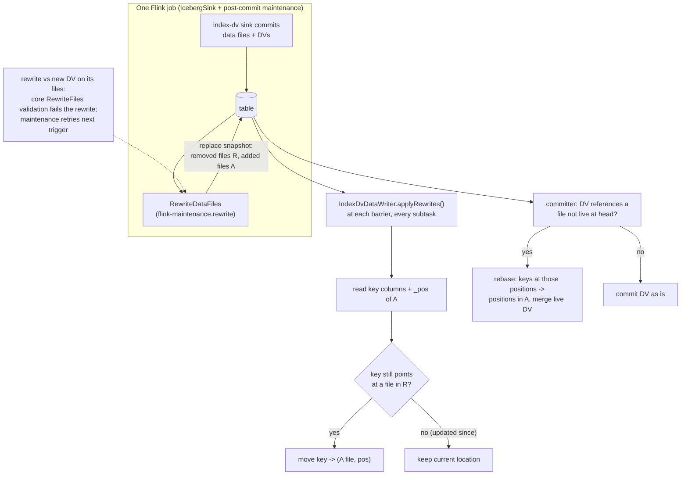
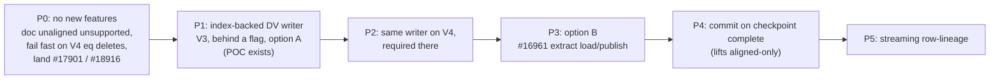

# Flink sink for Iceberg V4: upserts without equality deletes, and checkpoint-safe file completion

Status: DRAFT for author review. Not posted anywhere. Sources checked 2026-11-12 against `apache/iceberg` main at
`acea99d28` (code links pin that commit). Claims marked **[assumption]** have not been checked against code
or a discussion. Claims marked **[verify]** need a test or someone who knows the area to confirm them.

## 1. Motivation

- **V4 forbids new equality deletes.** The dev@ vote passed on 2026-08-18 with 7 binding +1s and no 0 or -1 votes
  ([vote][vote], [result][vote-result]). The spec text landed in [#17783][pr17783]: "Equality delete files must
  not be added to v4 tables", while eq deletes in carried-over v2/v3 delete manifests "must still be applied"
  ([spec.md][spec-v4]). Upgrading is metadata-only, and converting existing eq deletes to DVs is optional
  maintenance ([vote][vote]).
- **Flink is the main writer that still needs them.** Steven Wu: "We would need to migrate the Flink sink to leverage
  the index to produce DVs only in v4" ([thread][steven-1]). Ryan Blue framed it as a writer responsibility:
  "Instead of relying on async maintenance that didn't materialize, we need to make this a writer responsibility"
  ([thread][ryan-1]). Today `RowDataTaskWriterFactory` picks the writer by `formatVersion > 2` only
  ([code][c-factory]), so on a V4 table Flink upserts still produce eq deletes. #18748 says the same.
- **pvary listed prerequisites before fully moving off eq deletes** ([thread][pvary-1]):
  - (a) "We need an approach that avoids committing equality deletes to the table altogether". Today the converter
    still writes them to a staging branch.
  - (b) "The index needs to be written directly from the Flink job and reused across job restarts", for fast startup
    and cache warmup.
  - Nice to have: row IDs in streaming jobs, and incremental cache refresh on concurrent commits.
- **Forbid, not discourage.** Huaxin first proposed "deprecated but permitted" ([thread][huaxin-soft]). Max argued that
  this was too soft: "it doesn't give engines who write them a real incentive" ([thread][mxm-forbid]). Steven Wu
  "explicitly support[ed] disallowing" new eq deletes in v4 ([thread][steven-2]). Huaxin then switched to forbid
  ([thread][huaxin-forbid]). Ryan and Russell agreed that the replacement does not have to be finished before V4 is
  ratified ([ryan-2], [russell]). So **V3 stays the home for eq-delete writers until Flink can write DVs at write time.**
- **The current upsert design has a family of correctness bugs.** All of them come from eq-delete scoping rules or
  from per-writer, same-checkpoint bookkeeping:
  - [#18748][i18748]: after a partition spec change, upserts duplicate keys and deletes are lost. Eq deletes apply
    only to data files with the same spec id and partition, or when the delete is unpartitioned
    ([spec.md L1420][spec-eqscope]).
  - [#18262][i18262] and [#18350][i18350]: in `DynamicIcebergSink`, a schema change in the middle of a checkpoint
    splits one table across two writers. The second writer's `insertedRowMap` is empty, so it writes an eq delete
    with the same sequence number as the first writer's row, and that delete never applies. [#18288][pr18288] is a
    partial fix, and #18350 lists the cases it can't fix.
- **Unaligned checkpoints lose data in `FlinkSink`.** In [#15846][i15846], a `WriteResult` for checkpoint N that
  arrives after `snapshotState(N)` is dropped if N fails. We reproduced this on `flink/v2.3`
  ([comment][fm-15846]). On the closed [#15913][pr15913], pvary recalled agreeing with gyfora that "the unaligned
  checkpoint concept does not really allow committing a consistent state" without hand-built alignment
  ([comment][pvary-15913]). Max: "it's not possible to retain correctness with unaligned checkpointing enabled, at
  least not with the current design where we flush on receiving the checkpoint barrier. We would need a different
  design where we only finish writing when the checkpoint completes" ([comment][mxm-15846]). The docs say nothing
  about unaligned checkpoints (no hits for "unaligned" under `docs/`).

## 2. Goals and non-goals

**Goals**
1. Flink upsert and CDC writes that never commit an eq delete, to any branch, on V3 and V4 tables.
2. Reuse a key → (file, pos) index across restarts and rescaling, persisted in the Iceberg index format
   ([#16961][pr16961]) so other engines can share it.
3. Upsert correctness that does not depend on partition spec, schema id, or which writer instance handles a key.
   This closes the bug class behind #18748, #18262 and #18350.
4. A commit protocol that stays correct under unaligned checkpoints, or that fails fast and says why.
5. A migration path: V2/V3 eq-delete writers → index-backed DV writer on V3 → upgrade to V4.

**Non-goals**
- Kafka Connect. It has its own proposal: commit-time stateless conversion in the coordinator ([dev@][kc],
  [#18003][pr18003]).
- Changing the read path, or the index spec itself, beyond feedback on fit.
- Rewriting legacy eq deletes on upgrade. That stays optional maintenance (`ConvertEqualityDeletes`).

## 3. Current design and its problems

**Write path** (main, `flink/v2.3`):
- `BaseDeltaTaskWriter.write` handles upserts ([code][c-delta]). For an INSERT or UPDATE_AFTER in upsert mode it
  calls `deleteKey(key)` and then `write(row)`, and it turns a DELETE into `deleteKey`.
- In `BaseTaskWriter.BaseEqualityDeltaWriter`, `deleteKey` first tries `internalPosDelete` against `insertedRowMap`,
  the in-memory map of rows written by this writer in this checkpoint ([code][c-base]).
  - On a hit, it writes a position delete, or a DV through `PartitioningDVWriter` when `useDv` is set (V3+).
  - On a miss, it writes an **eq delete**.
- So DVs are only written for rows from the same checkpoint and the same writer. Anything older gets an eq delete.
- `IcebergCommitter` commits a `RowDelta` with **no conflict validation**. The code comment explains why: eq deletes
  apply to all earlier sequence numbers, and position deletes only target files added in the same commit
  ([code][c-committer]). Once we write DVs against *older* files, that reasoning no longer holds (see §4.1.5).
- The dynamic sink keys writers by `WriteTarget` (table, branch, schema id, spec id, upsert, equality fields), as seen
  in `DynamicWriter` and `WriteTarget` ([code][c-dynwriter], [code][c-writetarget]). Any change to that key starts a
  new `insertedRowMap`, which is the root cause in #18262.

**Checkpoint path:**
- `IcebergStreamWriter.prepareSnapshotPreBarrier` calls `flush(checkpointId)` and closes the open files
  ([code][c-streamwriter]).
- `IcebergFilesCommitter` collects results in `writeResultsSinceLastSnapshot` and moves them to
  `dataFilesPerCheckpoint` in `snapshotState` ([code][c-filescommitter]). This is the bookkeeping that #15846 breaks.
- The SinkV2 `IcebergSink` aggregates in `IcebergWriteAggregator.prepareSnapshotPreBarrier` ([code][c-aggregator]).
  Urs believed, with about 50% confidence, that the V2 sink is not affected ([comment][urs-v2]). **[verify]**

**Converter** (`ConvertEqualityDeletes`, Max):
- Writers still produce eq deletes. The converter reads them, resolves them through a sharded PK index in Flink keyed
  state (RocksDB), and commits data files plus DVs ([dev@][mxm-conv], [#17142][pr17142]).
- It runs either with a staging branch (the target branch never has eq deletes) or in place, which is the
  `IcebergSink` default. In-place mode lets readers see new data immediately but "doesn't guarantee that merge-on-read
  cannot happen" ([dev@][mxm-conv]).
- Key classes:
  - `EqualityConvertPKIndex`: keyed by the serialized PK. It uses generations to detect a stale index and resolves
    deletes in a sequence-number-aware way ([code][c-pkindex]).
  - `EqualityConvertDVWriter`: merges with the previous DV ([code][c-dvwriter]).
  - `EqualityConvertCommitter`: calls `validateFromSnapshot`, `validateNoConflictingDataFiles`,
    `validateNoConflictingDeleteFiles` and `validateDataFilesExist`, then `removeDeletes` ([code][c-convcommitter]).
- Recent work:
  - [#18717][pr18717] (merged 2026-11-10): incremental re-indexing from the data-file deltas of external commits. It
    still falls back to a full rebuild in several cases, for example after a rollback, after snapshot expiration, or
    when the delta would read more rows than a rebuild.
  - [#18674][pr18674]: index consistency after failure or restore. It names two constraints: conversion commits are
    independent of Flink checkpoints, and conversion failures must not fail the job.
- **Our operational experience:**
  - [#18435][i18435]: the converter never released the maintenance lock when combined with another maintenance task.
    It was fixed by [#18439][pr18439].
  - The converter works, but it is a second commit loop with its own lock, planner and failure modes, attached to
    every upsert table.

*Diagram: today's upsert path. Every key not written by the same writer in the same checkpoint becomes an equality delete.*

**Problems to solve:**
1. Eq deletes are still committed: to staging, or in place. This fails pvary's prerequisite (a).
2. The index is private to a Flink job and rebuilt on cold start. This fails prerequisite (b).
3. Correctness depends on eq-delete partition scoping and on per-writer maps (#18748, #18262, #18350).
4. File completion is tied to the barrier, which is unsafe with unaligned checkpoints (#15846).
5. Two commit loops (sink and converter) for one logical write. This adds latency (readers wait for the conversion in
   staging mode) and operational surface (#18435).

## 4. Proposed design

### 4.1 Resolve keys at write time and emit DVs, backed by a shared key index

**4.1.1 Data flow (validated by the POC, see "POC results, iterations 2–3").**
- The index lives in a keyed operator. A SinkV2 `SinkWriter` has no keyed-state access, so the POC puts the keyed
  operators in `IcebergSink`'s **pre-write topology**. The SinkV2 writer becomes a **pass-through relay**: it
  receives the serialized `WriteResult`s and returns them from `prepareCommit()`. The existing aggregator,
  committer and post-commit **table maintenance** stay unchanged.
- This depends on an ordering guarantee, which was verified (§4.5): with **aligned** checkpoints, results emitted
  from `prepareSnapshotPreBarrier(N)` reach the writer's `prepareCommit` for N. With unaligned checkpoints they
  don't, so the mode rejects unaligned checkpoints.
- The iteration-2 `FlinkSink` wiring still exists for comparison, marked deprecated in the POC.
- **The keyed operator is the data writer.** Rows are keyed by the serialized equality key, the full value and not a
  hash, as the converter does. The operator writes the data files itself, so it knows the (file, pos) of each new
  row when it writes it. Because of that, there is **no writer → index feedback path**: no iteration, no second
  shuffle, and no one-checkpoint lag. On every change to key K:
  1. Read K's packed location from `ValueState<Long>`, where the long holds a 32-bit file ID and a 32-bit position.
  2. If one is found, emit `DVPosition(file, pos)` to a side output.
  3. For an upsert, write the new row and store its location.
- **DV writer keyed by data file path.** It receives the side output, keeps the last DV of each file in keyed state,
  and merges the new positions into it. So each data file gets exactly one DV per checkpoint, and DVs from different
  key owners never collide. Both operators flush at the barrier and feed the existing `IcebergFilesCommitter`
  through `union`.
- **The file dictionary maps file IDs to (path, spec ID, partition) and lives in union operator state.** It is tiny,
  one entry per data file, and every subtask can resolve any file ID after a rescale. File IDs embed the creating
  subtask, so IDs stay unique across rescales.
- **Commit.** The committer removes the live DV of every touched data file. It validates from this sink's last
  snapshot, or from the bootstrap snapshot before the first commit, using `validateDataFilesExist`,
  `validateDeletedFiles` and `validateNoConflictingDeleteFiles`. Without a starting snapshot, core's DV check
  scans all history.
- **The bug class goes away.** The index is per table and key, and positions are global rather than
  partition-scoped, so #18262, #18350 and #18748 can't happen by construction. #18748 is reproduced and fixed in the
  POC. **[verify]** Key serialization must stay stable across the type promotions and optionality changes in
  #18350.
- **It reuses the converter's pieces:** `StructLikeSerializer`, `DVPosition`, `BaseDVFileWriter` and
  `BaseDeleteLoader`.

```mermaid
flowchart LR
  IN[upsert rows] --> KB["keyBy serialized equality key"]
  subgraph PRE["IcebergSink pre-write topology (POC)"]
    KB --> DW["IndexDvDataWriter (keyed)<br/>ValueState&lt;Long&gt; key -> fileId|pos (RocksDB)<br/>union state: fileId -> path, spec, partition"]
    DW -- "side output DVPosition(file, pos)" --> KF["keyBy data file path"]
    KF --> DVW["IndexDvDeleteWriter (keyed)<br/>last DV per data file (RocksDB)"]
    DW -- "WriteResult: data files" --> U(("union"))
    DVW -- "WriteResult: DVs" --> U
    U --> ENC["relay encoder<br/>WriteResult -> bytes"]
  end
  ENC --> RW["IndexDvRelayWriter<br/>pass-through SinkV2 writer"]
  RW --> AGG["IcebergWriteAggregator<br/>(global)"]
  AGG --> COM["IcebergCommitter<br/>IndexDvCommits: validate, rebase, merge live DV"]
  COM --> T[(Iceberg table:<br/>data files + DVs, no eq deletes)]
  COM -. post-commit .-> MNT["TableMaintenance<br/>(flink-maintenance.*)"]
  MNT -.-> T
```

*Diagram: the POC's index-dv topology on `IcebergSink`. Solid arrows inside the box carry data files (top) and retired positions/DVs (bottom).*

**4.1.2 Where the index lives.** (A) is now measured; (B) remains the target for sharing.

| Option | Status | Pros | Cons |
|---|---|---|---|
| A. Flink keyed state (RocksDB) | **Implemented in the POC; measured at 10M keys** (§4.4) | Rescales with key groups (tested 2 → 4 from a savepoint); incremental checkpoints are small in steady state; about 15 B/key on disk | Not shared. A fresh job pays a full bootstrap. Lookups must hit the RocksDB block cache or throughput collapses (§4.4) |
| B. Iceberg index ([#16961][pr16961]) as the durable base, with A as the hot layer | Not built | Shared across engines; a fresh job loads an extract instead of scanning data files | Extract publication cost (below); two layers to keep consistent |
| C. External KV store | Rejected (§5) | Fast lookups | New dependency; a second source of truth |

*Diagram: one checkpoint in the POC. Results emitted from `prepareSnapshotPreBarrier(N)` reach the relay writer's commit for N because the barrier is broadcast only after the hook returns (§4.5).*

**4.1.3 Fit with the index spec (#16961).**
- The spec's Appendix C "key lookup index" is the shape we need: identity columns for the key plus `_file` and
  `_pos`, ordered by `[bucket(N, key), key]` ([spec draft][idx-spec]).
- An extract "must index exactly the live rows of the referenced table snapshot", and an index may lag the table, in
  which case engines "must reconcile the extract against the source-table snapshot" ([spec draft][idx-spec]). That
  matches B: Flink reconciles by replaying the snapshot delta.
- **Concern: write amplification.** Region files must be globally ordered and non-overlapping. Streaming upserts touch
  keys roughly uniformly, so any extract publication after a few checkpoints would rewrite most region files.
  Shawn Chang raised the same cost on dev@ ([thread][shawn]), and Ryan mentioned a "base + at most one overlay"
  alternative there.
  - Proposal: publish extracts at a coarse cadence, for example every N commits or minutes, as a post-commit task,
    and keep the delta in Flink state.
  - Open question: whether the spec should allow a bounded overlay, which would make streaming publication much
    cheaper.
- `_row_id` as an identity column (spec Appendix B) would let the writer carry the old row's ID onto the new row.
  That is pvary's "row IDs in streaming jobs" nice-to-have. Today eq-delete upserts always assign new row IDs
  ([spec.md L546][spec-lineage]). **[assumption]** The writer would need `_row_id` in the index, or one extra read,
  and a way to write an explicit row ID for the new row.
- A reference implementation for Core and Spark exists in [#18187][pr18187] (osscm, open), and REST endpoints are
  proposed in [#16963][pr16963]. Flink could build on #18187's Core layer once it is reviewed. **[verify]** Check its
  API before designing against it.

**4.1.4 Restarts, rescaling, partition evolution.**
- *Restart from a checkpoint:* restore the keyed state, then reconcile against the table head the same way
  [#18674][pr18674] does. The index can be used only if the head is the indexed snapshot, or our own next commit;
  otherwise apply the delta or rebuild.
- *Rescaling:* Flink key groups redistribute the shards. Nothing Iceberg-specific is needed. The POC tests 2 → 4 from a savepoint; the file dictionary is union state.
- *Fresh job or no state:* load the newest extract (option B), then apply the delta. Without an index, do a full
  scan, which is today's converter behavior.
- *Partition evolution:* the index is keyed by the PK, not by partition, so a spec change does not matter for
  lookups. The `keyBy` must stay on the equality key; for the dynamic sink this replaces partition-based routing in
  upsert mode. **[verify]**

**4.1.5 Concurrent writers and compaction.**
- DVs against older files make the commit sensitive to concurrent changes. The commit must:
  - validate from the snapshot the index reflects;
  - check that the files referenced by DVs still exist (`validateDataFilesExist`);
  - reject conflicting DVs for the same files (`validateNoConflictingDeleteFiles`).
  The converter's committer already does all three ([code][c-convcommitter]).
- *On conflict* (typically compaction):
  1. Apply the conflicting commit's file delta to the index: evict removed files, index added files. This is
     incremental, as in #18717.
  2. Re-resolve only the affected keys.
  3. Retry. Fail after a bounded number of retries.
- pvary warned on the KC thread that faster resolution makes starvation of concurrent commits worse ([dev@][pvary-kc]).
  **Open question:** should compaction yield to the sink, or the reverse? For index-dv tables §4.5 recommends
  in-job compaction.
- This overlaps with our open work on commit validation in `IcebergSink`: [#17901][pr17901] and [#18916][pr18916].
- Multiple Flink writers on one table with overlapping keys are out of scope for v1 of this design: one writer job
  owns the keys.

### 4.2 Decouple file completion from the checkpoint barrier

**Proposal.** Finish files and commit only for *completed* checkpoints, keyed by the checkpoint ID the writer
assigned, never by the order of arrival at the committer.
1. **Writer.** At the barrier, *seal* the logical batch for checkpoint N: record its open files and pending DV
   positions in operator state. Physically closing files can still happen early. The files of N only become
   committable after `notifyCheckpointComplete(N)`. **[assumption]** That gives the latest possible point for
   records buffered by unaligned checkpoints to land in N's batch. How that maps onto Flink's channel-state
   semantics is the core open question. Max's comment points this way; pvary's says it may not be achievable without
   effectively re-aligning.
2. **Committer.**
   - Index pending results by `(writer subtask, checkpointId)`.
   - Commit N only when every subtask has reported N. SinkV2 `CommittableSummary` already carries per-subtask counts.
     **[verify]** whether that suffices.
   - Never let N+1 overwrite N's pending set, which is the #15846 bug.
3. **Fallback.** If (1) proves infeasible, the sink detects unaligned checkpointing in `open()` and fails with an
   actionable message. Urs suggested this ([comment][urs-guard]). It is a behavior change for current users, so make
   it opt-out.

*Diagram: why unaligned checkpoints shift results after a network hop by one checkpoint (`TestPreWriteBarrierOrdering`, union shape). A DV from N committed after its data file from N+1 would carry a lower sequence number and not apply, so index-dv rejects unaligned checkpoints.*

**How 4.1 and 4.2 interact.**
- The index has *committed* entries and *pending* entries from N, N+1, and so on. A DV produced in N+1 can point at a
  file from N that is not committed yet, so commits must be ordered: N before N+1, or both in one commit.
- On restore, pending entries newer than the last committed checkpoint (read from the snapshot summary's
  `flink.max-committed-checkpoint-id`) are dropped, and the replayed input rebuilds them. **[verify]** Resolution must
  be deterministic under replay.
- So the index state and the committer state must be snapshotted at the same checkpoint. That is natural if the
  index shard lives in the writer operator.
- **Order the work:** (1) can ship first with aligned checkpoints required; (2) then removes that restriction.

### 4.3 Distribution modes

**What upsert does today.** Both `FlinkSink` and `IcebergSink` handle `write.distribution-mode` this way for upsert
(`FlinkSink#distributeDataStream`, `IcebergSink#distributeDataStream*`):
- **none:** keyBy equality fields.
- **hash, partitioned table:** keyBy partition. Partition source columns must be in the equality fields (a
  `Preconditions` check), so every key always lands on the same writer. One writer per partition means about one
  file per partition per checkpoint.
- **hash, unpartitioned table:** keyBy equality fields.
- **range:** falls back to keyBy equality fields with a warning, because range with equality fields isn't
  supported.

So **hash on a partitioned table is the only upsert layout that differs from key distribution.**

**What index mode does (POC).** It always distributes by equality key, logs a warning for hash on partitioned tables
and for range, and drops the "partition sources ⊆ equality fields" requirement, because the index is global.
Measured with 5 checkpoints of upserts at parallelism 2 (`TestIcebergSinkIndexDv`, `LAYOUT` output; live data files
per partition at the end):

| distribution | table | eq-delete mode | index-dv mode | correct |
|---|---|---|---|---|
| none | unpartitioned | 10 | 10 | yes |
| none | bucket(id,3) | 10 / 9 / 10 | 10 / 9 / 10 | yes |
| hash | bucket(id,3) | **5 / 5 / 5** | 10 / 9 / 10 | yes |
| range | unpartitioned, sorted by id | 10 | 10 | yes |
| range | bucket(id,3) | 10 / 9 / 10 | 10 / 9 / 10 | yes |

**Layout cost.** Under hash, index mode writes up to `writeParallelism` files per partition per checkpoint instead of
one, so the file count grows ×P. Compaction absorbs this, but small-file pressure and manifest size grow with P on
wide partitioned tables.

**Separating key resolution from file writing, so hash and range can be honored, needs one of these:**
1. **A feedback path.** The resolver (keyed by key) sends rows to writers distributed by partition or range, and
   writers report each new row's (file, pos) back to the resolver. Flink 2 has no iterations, so this needs an
   external channel: either the shared index (B) or a side store. The resolver also can't resolve a key
   re-written within the same checkpoint until the feedback arrives, so the writer has to keep a per-checkpoint
   `insertedRowMap` (the existing same-checkpoint logic) and the resolver has to tolerate a one-checkpoint lag.
2. **A partition-scoped index.** Key the writer by partition and keep `MapState<key, location>` per partition. That
   honors hash with one writer per partition, but the scope breaks on a partition spec change (the #18748 class
   again) unless the routing spec stays frozen.
3. **Deterministic positions.** The resolver chooses the target file and row order. This gives at most one file per
   (resolver subtask, partition), the same layout as key distribution, so it buys nothing.

Recommendation: keep "index mode forces key distribution" for v1 and document the ×P files per partition under
hash. Revisit once the shared index exists (option 1 then becomes "writers publish positions to the index").

**DynamicIcebergSink.** It distributes per record in `HashKeyGenerator`, with the same per-mode rules per table, and
routes on a generated *integer writer key*, not on the row key. Index mode there would need:
- keyed state on (table, equality key), or `MapState<(table, key), location>` under the writer key;
- a per-table bootstrap on first sight of a table;
- per-table memory budgeting across many tables (the #17142 concern);
- key encoding that stays stable across in-flight schema changes (#18350).

§4.6 has the design and the POC.

### 4.4 Scaling (measured, POC)

Rough local numbers, labelled as such: a laptop under macOS memory pressure, in-JVM MiniCluster, parallelism 2,
RocksDB with incremental checkpoints on local FS, 1 GB managed memory (512 MB per slot), 1.5 GB test heap, Parquet,
an unpartitioned v3 table with 8 MB target files (10M keys = 12 data files). The workload is an append-only load of
10M keys, then one upsert job with 1M random updates followed by 1M updates to a contiguous ID range, each in 2
batches separated by 2 completed checkpoints (1 s interval). `IndexDvScaleBenchmark` was run twice per mode; both runs
are shown as r1 / r2.

| metric | equality-delete | index-dv |
|---|---|---|
| bootstrap (10M keys, every subtask reads the key column + `_pos`) | n/a | 10.2 / 9.6 s |
| 1M random updates, phase wall time | 4.0 / 4.0 s | 5.3 / 5.5 s |
| 1M clustered updates, phase wall time | 4.0 / 4.0 s | 5.3 / 5.2 s |
| checkpoint duration, median / max | 43 / 343 ms; 41 / 215 ms | 269 / 2466 ms; 358 / 2494 ms |
| full state on disk (last checkpoint) | ~7 KB | 147 MB (≈14.7 B/key) |
| incremental checkpoint, max | 6.8 KB | 147 MB (the first checkpoint after bootstrap) |
| DVs / eq-delete files per commit, random phase | 2 DVs + 2 eq files | 6, 8 DVs (of 12 data files) |
| DVs / eq-delete files per commit, clustered phase | 0 DVs + 2 eq files | 5, 5 DVs |
| planFiles | 41 / 18 ms | 16 / 20 ms |
| full scan of 10M rows, single thread `IcebergGenerics` | 3.8 / 3.2 s (applying 2M eq-delete rows) | 1.18 / 1.15 s |

How to read this:
- **Phase wall time has a floor of about 4 s** (2 batches × 2 checkpoint waits). Eq-delete mode sits on the floor,
  so its real cost is hidden. Index-dv adds about 1.2–1.5 s per 1M updates over the floor, which puts it at
  **≥ ~185k updates/s end to end**. That is a lower bound, not peak throughput.
- **Cache residency is the cliff.** With 512 MB managed memory split over 4 slots (about 64 MB block cache per slot
  for about 75 MB of SST per subtask), the same 10M-key run took 43–79 s per phase. Checkpoints took 39–75 s, almost
  all of it barrier start delay behind backpressured `RocksDB.get` lookups, and results varied run to run with host
  memory pressure. With the cache covering the state, it was stable at about 5.5 s. **Production sizing must keep the
  index's working set in the block cache**, or put it on fast local disk with bloom filters (not tested).
- Clustered and random look alike here only because the table has 12 files. Clustered updates touch fewer files
  (5 vs 6–8) and would diverge on tables with thousands of files.

**Extrapolation (not measured; linear assumptions, labelled):**
- State is about 15 B/key compressed, so 1B keys ≈ 15 GB of RocksDB across the job, before replication of the file
  dictionary.
- Bootstrap reads the key column of every data file on every subtask (P× read amplification). At about 1M keys/s per
  subtask locally, 1B keys would take roughly 15–20 minutes per fresh start, independent of P because each subtask
  reads everything. That is the strongest argument for option B or a split-read bootstrap.
- The first checkpoint after bootstrap uploads the whole state: 147 MB here, about 15 GB at 1B keys.

**Costs that grow with table size**
- **Bootstrap:** linear in rows × P, and paid on every start without state.
- **Compaction re-indexing:** a rewrite moves rows, so every moved key's location must be updated. Implemented in
  iteration 3 (§4.5): an index delta reads the key columns plus `_pos` of the added files on every subtask, and a
  commit rebase handles the lag. The cost is proportional to the compacted volume times P.
- **DV churn:** each touched data file's DV is rewritten cumulatively on every checkpoint. Random updates touch most
  files on every checkpoint, so DV bytes per commit grow with total deletes per file until compaction. Clustered
  workloads touch far fewer.
- **File dictionary:** union state, one entry per data file ever written (no GC in the POC), replicated to every
  subtask.
- **Commit:** the POC scans every delete manifest of the head to find live DVs, which is O(DV count) per commit.
  This needs a DV lookup.

**Remaining risks**
- **Compaction cost.** The restart loop is fixed by the index delta plus the commit rebase (§4.5); the cost and starvation remain open.
- **Cache-cliff throughput.** Lookups degrade badly when the index doesn't fit the block cache.
- **P× bootstrap read amplification.**
- **Single sink per table assumed.** Validation only covers others' DVs added after our last commit.
- **Dictionary growth.**
- **No savepoint compatibility promise.** Everything is POC operator state with no versioning.

### 4.5 In-job maintenance and compaction (POC, iteration 3)

**Ordering guarantee: pre-write results versus the SinkV2 commit.**
- **Source level** (Flink 2.3 bytecode):
  - `SubtaskCheckpointCoordinatorImpl.checkpointState` calls `OperatorChain.prepareSnapshotPreBarrier(id)` and
    only then builds and broadcasts the `CheckpointBarrier`.
  - The broadcast is a priority event exactly when `isUnalignedCheckpoint()`.
  - Within a chain, operators are visited head to tail.
  - `SinkWriterOperator.prepareSnapshotPreBarrier` calls `writer.flush(false)` and then `prepareCommit()`.
- **Empirical** (`TestPreWriteBarrierOrdering`, about 59 checkpoints × 2 subtasks per case): an operator in front of
  the writer emits a marker tagged N from `prepareSnapshotPreBarrier(N)`, and the writer records which tags it hands
  over in its commit for N.

| topology | aligned | unaligned |
|---|---|---|
| chained (operator → writer in one task) | 0 / 120 late | 0 / 120 late |
| unchained (network, forward) | 0 / 120 late | 0 / 120 late |
| union with a second hop (the DV-writer shape) | 0 / 240 late | **118 / 240 late by one checkpoint** |

- **Conclusion.** With aligned checkpoints the guarantee holds in every shape, so the pass-through writer is
  correct. With unaligned checkpoints, results after a network hop can slip to N+1.
  - A DV of N could then commit before its data file (N+1).
  - With a lower sequence number, that DV wouldn't apply.
  - So the mode **rejects unaligned checkpoints** at topology build.
- **A second finding.** An operator must emit its last results in `endInput` and never from
  `prepareSnapshotPreBarrier` after `endInput`. Otherwise the writer fails with "Received element after endOfInput"
  on the final checkpoint. The POC writers follow this rule.

**In-job maintenance.** With index-dv on `IcebergSink`, `flink-maintenance.*` runs in the same job. Tested:
- `RewriteDataFiles` on every commit (`rewrite-all`) while upserts flow;
- that combined with `ExpireSnapshots` and `ConvertEqualityDeletes`. The converter is a no-op: it finds no equality
  deletes.

**Compaction handling.**
1. **Index delta.** At each barrier, every data-writer subtask reads the `replace` snapshots committed since its
   last view. For the rewrite's added files it reads the key columns plus `_pos`, and moves an owned key to its new
   (file, pos) only if the key still points at a file that rewrite removed. A key updated since then already points
   elsewhere. The last seen snapshot is union state, so a restore or rescale resumes from the oldest view; re-applying
   is harmless. This is the #18717 idea applied to keyed state.
2. **Commit rebase.** DVs already emitted before the index catches up still point at removed files. The committer
   checks each referenced data file for **liveness against the head's data manifests**. A window-based check was
   tried first and produced duplicates, because a rewrite can land before this sink's previous commit.
   - For a removed file F:
     1. Find the `replace` snapshot that removed it.
     2. Drop positions F's DV already had at that rewrite's parent.
     3. Read F's keys at the remaining positions.
     4. Locate those keys in the rewrite's added files, following later rewrites.
     5. Write DVs there.
   - The new DV is always merged with the target file's live DV, because the DV writer never saw DVs that a rebase
     created. Validation then runs from the head.
3. **Bounded retries.** A commit that still fails validation is rebuilt against the new head, up to 4 attempts.

*Diagram: in-job compaction and how the POC keeps the index and the in-flight DVs correct after a rewrite.*

**Races, defined.**
- *Rewrite planned, then this sink adds a DV to one of its files:* core's `RewriteFiles` validation (no new deletes
  for replaced files since the starting snapshot) fails the rewrite, and the maintenance task retries on its next
  trigger. The sink always wins, which is pvary's starvation concern; it didn't stop rewrites in these tests.
- *Rewrite commits, then this sink commits a DV on a removed file:* rebased as above. It never loops, because the
  rebase validates from the head.
- *Rewrite commits between `build()` and `commit()`:* `validateDataFilesExist` fails, and the retry rebases.
- *Removal is no longer in history, or the removed file is gone:* the commit **fails loudly** ("can't be rebased")
  rather than committing a dangling DV. This guards against too-aggressive `ExpireSnapshots` or orphan cleanup
  while the index is behind. It wasn't triggered in tests.
- *Non-rewrite removal* (an overwrite or delete by another writer): fails loudly. The POC is single-writer.

**Measured in tests** (parallelism 2, about 8 batches of 60 upserts over 30 keys):

| scenario | rewrite commits | DVs rebased | commit retries | index deltas applied | result |
|---|---|---|---|---|---|
| in-job rewrite, unpartitioned | 8 | 8 | 0 | 12 | correct, no eq deletes, no restarts |
| in-job rewrite, bucket(id,3) | 7 | 23 | 0 | 12 | correct |
| in-job rewrite + expire + converter | 4 | 3 | 0 | 6 | correct |
| external compaction between checkpoints (2×) | 2 | 9 | 0 | 16 | correct |
| savepoint, then external compaction, then restore | 1 | not recorded | not recorded | not recorded | correct |

**Recommendation: in-job compaction only.**
- Index-dv tables should run compaction in-job, through `TableMaintenance` under the maintenance lock, as the POC
  does.
- External compactors on these tables are unsupported in v1: back-to-back external rewrites starve the sink (k4x,
  iteration 4).
- A compaction rule that skips files with fresh DVs would keep external compactors; see §5.

**Remaining gaps**
- **Rebase cost.** Rebase reads the old file and the rewritten files on the single committer: O(rewritten bytes)
  per affected commit. Index deltas read added files on **every** writer subtask.
- **Starvation, measured in iteration 4.** External rewrites landing faster than one sink commit starve the sink
  (k4x); in-job and 500 ms external rewrites don't (k4, k5). Hence the recommendation above.
- **Expire and orphan cleanup race the index** while it lags. Fail-loud only; needs a "don't expire past the slowest
  sink view" rule, or snapshot references.
- **No partial rewrites** (only `rewrite-all` was tested) and no `rewrite-position-deletes`.
- **Liveness and DV lookups scan all data and delete manifests** of the head on each commit with DVs.
- **No `DynamicIcebergSink`** (§4.3).

### 4.6 DynamicIcebergSink

**What exists today** (read on `poc-flink-index-dv-writer`, Flink 2.3 module):

- The generator (`DynamicRecordProcessor`) resolves each `DynamicRecord` against `TableMetadataCache`.
  - It emits upsert records on the main output with a generated integer `writerKey` from `HashKeyGenerator`.
  - It sends records whose table needs an update through the `Updater` (keyed by table name) and unions them back
    in.
  - Records with no equality fields and no distribution mode take the chained forward writer instead.
- The sink keys by `writerKey`. `DynamicWriter` writes one `TaskWriter` per `WriteTarget` (table, branch, schema id,
  spec id, upsert, equality fields).
- `DynamicWriteResultAggregator` (keyed by table name) writes one manifest set per `TableKey` and spec.
- `DynamicCommitter` commits per table. It skips checkpoints already committed by the same sink id and operator id
  (#18807).
- `addPostCommitTopology` is empty: **the dynamic sink has no in-job maintenance today.**

**(a) Routing.**

- **The writer key cannot be the state key.** `HashKeyGenerator` maps an equality key to one of a table's
  `writeParallelism` integer slot keys (`TargetLimitedKeySelector`), so every key of a table on a subtask shares one
  Flink key.
- **Option A (POC): key upsert records by the composite (table, branch, equality key).**
  - The keyed index state and the routing then agree, and rescale moves state with Flink's key groups, as in
    single-table index mode.
  - It bypasses `HashKeyGenerator` for those records, so per-table `writeParallelism`, distribution mode and
    distribution fields are not honored. Every table spreads over all index-writer subtasks.
  - The cost is up to P files per table per checkpoint (×P files, §4.3), now multiplied by the number of tables
    written in that checkpoint.
- **Option B: keep routing on `writerKey`, with `MapState<key, location>` under it.**
  - It honors per-table write parallelism and distribution.
  - But the key → `writerKey` mapping depends on the table name hash, `writeParallelism` and max parallelism. Any
    change to them misplaces state, so it needs a per-table rebuild. Every state entry of a table slot also sits
    under one Flink key.
- **Recommendation:** A for v1, B as a follow-up if small files per table dominate.
- **Ordering [verify]:** records that take the `Updater` path are unioned back in front of the keyBy, so a record of
  key k on that path can be overtaken by a later record of k on the main path. Eq-delete mode has the same exposure.
  For index mode, the POC tests use `immediateTableUpdate(true)`.

**(b) State layout.**

- **Index: keyed `ValueState<Long>` (file id, pos) under the composite key**, one RocksDB entry per (table, key).
  - `MapState` per table would need a table-level Flink key, which puts a whole table on one subtask, so it is
    rejected.
- **File dictionary: per subtask, entries tagged with the table**, kept as union operator state like the
  single-table writer.
  - Union state is replicated to every subtask on restore and held on heap: O(files across all tables × P).
  - That is the first scaling limit for many tables. Next options: keep the path in the location value (bigger
    entries), or keyed or broadcast dictionaries per table.
- **Per-table metadata (union state):** last seen snapshot, equality field ids, and the key-group ranges already
  bootstrapped (next item).

**(c) Lazy bootstrap and restore, per table.**

- **First record of a (table, branch) on a subtask:**
  - load the table;
  - index the live rows of the branch head whose composite key falls in the subtask's key groups;
  - record those key-group ranges as covered.
- **After a restore or rescale**, a subtask bootstraps only the key groups it owns that no earlier subtask covered.
  - Keys there were never written by this sink, so no pending result can be overwritten.
  - Different subtasks may bootstrap a table at different heads. That is safe because keys are partitioned
    [verify at scale].
- **Fail-fast** (§4.1, iteration 4) runs per table on that table's first record after a restore: walk the head back
  to the table's last seen snapshot and fail on a non-rewrite snapshot that added a data file the dictionary lacks.
  - Tables that never see another record are never checked; their index is unused.
- **`upsert-stale-restore=rebuild`** would clear only that table's keys. That needs an iteration over keyed state
  filtered by table, or a per-table key prefix scan in RocksDB [verify]. It is not in the POC slice.
- **Index deltas** (rewrites) are applied at the barrier for tables written since the last barrier only. That keeps
  the per-barrier cost at O(tables written), not O(tables known).

**(d) Memory and state with many tables (#17142).**

- **State per key** = composite key bytes (table name + branch + key) + 8 bytes. A table id would save about 30
  bytes per key over the name; the measurements are in the report.
- **Heap per subtask:**
  - the file dictionary across tables (item b);
  - per-table `Table` objects, writer factories and open rolling data writers. Up to one open Parquet writer per
    (table, schema, spec, partition) per subtask until the barrier, a few MB each.
- **Needed for many tables:**
  - an LRU budget on open writers that rolls a file on eviction;
  - an LRU on table metadata;
  - dictionary GC.
- **Bootstrap** of a large table blocks its subtask on first sight. Budget: about 1 s per 1M keys per subtask
  (§4.4).

**(e) Key encoding across schema changes (#18350).**

- **Encoding.** The key is the equality columns projected in field-id order and encoded by `StructLikeSerializer`.
  It is stable when non-key columns are added, dropped or reordered, and when the schema id changes.
- **When it changes.** It changes with the equality field set, with a key column's type (int → long promotion), or
  with a key column's id.
- **On such a change** the table's index is invalid. The POC fails loudly. A real implementation rebuilds that
  table's index.
- **Recorded signature.** The equality field ids are recorded per table in state and compared on every record.
- **POC requirement.** The record's equality fields must equal the table's identifier fields, because the committer
  needs the key columns for the rebase. A real implementation carries the key field ids in `DynamicCommittable`
  instead [design].

**(f) Commits.**

- **No change to the topology.** The index path writes data files and DVs before the SinkV2 writer. A relay writer
  (`SinkWriterOperatorFactory`, as the forward writer does) emits `DynamicWriteResult` per (table, branch, spec),
  unioned into the existing aggregator and committer.
- **DVs are split by their own spec**, because the aggregator writes one manifest set per spec.
- **`DynamicCommitter` in index mode commits each table and checkpoint through `IndexDvCommits`**: rebase over
  rewrites, liveness against the head, merge with live DVs, bounded retries.
  - It keeps its own summary keys, max-committed check and `MaxCommittedCheckpointIdValidator`.
  - Sink-id matching (#18807) is unchanged.
- **The per-table bootstrap snapshot is not known to the committer.** `validationStart` falls back to the sink's last
  own snapshot, then to the head. That is safe because every DV is merged with its file's live DV at the head
  [verify under concurrency].

**(g) Tables appearing, dropped tables, branches.**

- **A table created on the fly** has an empty head, so the bootstrap is a no-op.
- **A dropped table** leaves keyed entries and dictionary entries behind. That needs a TTL or cleanup when the
  table is missing.
- **A table dropped and re-created under the same name** gets a new UUID, so a new table id and a fresh index
  bootstrapped from its own head (see the table id below). The old table's keys are never looked up again.
- **Branches:** the index is per (table, branch). A key written to two branches has two independent entries. A new
  branch bootstraps from its own head.

**Table id in the key (POC `79e04c82f`).** The key is (table id, equality key). The table id is the first 64 bits
of `murmur3_128(table UUID, branch)`, as a fixed 8 bytes in front of the unchanged equality key. It replaces the
`writeUTF(table) + writeUTF(branch)` prefix.

- **Requirements:** identical on every subtask and across restore, rescale, a savepoint into a new job and
  restarts without state; never reused for another (table, branch).
- **Chosen: a hash with collision detection.** It needs no coordination.
  - A union-state registry would let two subtasks assign different ids to a new table in the same interval.
  - An OperatorCoordinator removes that race, but adds an RPC per new table and still persists a mapping.
- **Collision risk:** about n²/2⁶⁵ for n (table, branch) pairs ever held: 2.7·10⁻¹⁴ at 10³ and 2.7·10⁻⁸ at 10⁶.
  The per-table metadata records the UUID and branch behind each id. A collision fails the job before the second
  table's keys are read.
- **The key is attached before the key-by:** a chained `DynamicIndexDvKeyAssigner` resolves the UUID, refreshed
  every `dynamic-sink.cache-refresh-ms`. The receiving side then uses exactly the key the record was partitioned by,
  even across a re-create.
- **Rename** keeps the UUID, so the index follows the table under its new name. Records still addressed to the old
  name fail, or create a new table with its own index.
- **Re-create:** records keyed with the old UUID after it fail loudly at the next barrier, because the table refresh
  sees a changed UUID. They are keyed for the new table after the restart.
- **Key format:** the per-table metadata carries the key format version (2) under a new union-state name.
  - Format 1 state fails loudly on the table's first record.
  - With `upsert-stale-restore=rebuild`, the table is indexed from its head instead; format 1 keys never match
    format 2 keys.
  - There is no migration.

**(h) Compaction.**

- **index-dv on DynamicIcebergSink is experimental in v1.** §4.5's rule (in-job compaction, no external
  compactors) stays the recommendation for `IcebergSink`; the dynamic sink cannot meet it yet, because it has no
  post-commit maintenance.
- **v1 allows external compaction at a modest cadence.** The dynamic path uses the same commit rebase
  (`IndexDvCommits`), the same per-barrier rewrite reconciliation and a per-table restore check.
  - **Ported cases:** the single-table compaction cases (c1–c6, k1–k4x) were run on the dynamic sink, with three
    tables in one stream and every rewrite targeting one of them (`9a4858de1`). Every case matched `IcebergSink`.
    The tables the rewrite did not target were never affected.
  - **The only failure is starvation:** back-to-back rewrites starve the sink (k4x), and that fails loudly.
  - **One false failure was found and fixed (`006177e5b`):** an idle table's last seen snapshot lagged the sink's
    own last commit, so compaction plus expiry made a correct restore fail (c5a).
- **Proposed replacement: per-table in-job maintenance.** One `TableMaintenance` pipeline keyed by table name, with
  per-table triggers, under a maintenance lock per table, fed by the committer's per-table results. Not built:
  `TableMaintenance` / `TriggerManager` are single-table [verify], and the dynamic sink's `addPostCommitTopology`
  is empty, so it needs new keyed-trigger and lock plumbing, plus a bound on how many tables compact at once.

**POC (2026-11-14, local only, `f7a7c4351`, `d0b20fc90`, `c6758e811`)**

- **What is in the slice:**
  - option A routing;
  - lazy per-table bootstrap of uncovered key groups;
  - the per-table fail-fast restore check;
  - a relay into the existing aggregator;
  - `DynamicCommitter` committing through `IndexDvCommits`.
- **What it requires:** equality fields that equal the table's identifier fields, V3 tables and aligned
  checkpoints. Anything else fails loudly.
- **Tests:** `TestDynamicIcebergSinkIndexDv` 8/8, in three runs in a row.
  - Coverage: 3 tables with interleaved upserts, deletes and duplicates (the same rows as eq-delete mode, 0 eq
    deletes), a table appearing mid-stream, a bootstrap over eq-delete history, failover, rescale 2 → 4, a stale
    restore that fails only for the stale table, and an added non-key column.
  - All dynamic sink suites and `TestIcebergSinkIndexDv` still pass.
- **Two bugs found and fixed while building it:**
  - a lazy bootstrap inside `processElement` left the keyed backend on the last indexed key;
  - a filter at the wrong parallelism reordered records of a key before the key-by.
- **Rough numbers:**
  - 3 tables × 1M keys: 12.7 state bytes per key, against 11.2 for single-table index-dv at 3M keys.
  - The table-name prefix costs almost nothing on disk in RocksDB.
  - UUID string keys cost about 37 B/key against 13–17 for int keys; a 64-bit hash about 22 B/key, plus collision
    handling.
- **Update throughput, profiled (`9ecdeeec0`, `a65931083`):**
  - **The "2×" came from comparing two different harnesses.** On one harness, with the same phases, keys,
    parallelism and checkpoint waits, dynamic-3 runs at 205k updates/s against 255k for single (−20%). Dynamic with
    one table is −17%, so the gap is not the number of tables.
  - **Most of what remains is the key length.** Single-table with the same table+branch prefix on every key adds
    +823 CPU-ms per 1M updates on the writer, almost all of it in RocksDB put/delete. After the key-selector fix,
    dynamic-3 is only +110 over that.
  - **The fix:** removing the per-record cache-key string and key re-encoding cut key-selector CPU by 55% and its
    allocation by 62%. The throughput change stayed within noise.
  - **Table id instead of the name (`79e04c82f`):** in the same session, dynamic-1 went from 216k to 237k updates/s
    (−4% vs single) and dynamic-3 from 199k to 216k (−12%).
    - Writer CPU fell 6.5%, and RocksDB put/delete went back to single's level.
    - State per key is unchanged within noise: 17.2 B/key with the id, against 17.1 with no table part.
    - What remains for dynamic-3 is mostly `DynamicRecordInternal` deserialization.
- **Details:** `reports/2026-11-14-v4-dynamic-sink-index-dv.md`.

## 5. Alternatives considered

- **Converter only (status quo).**
  - Works on V3 today. It cannot be used on V4 because eq deletes may not be added at all, staging branch included.
    **[verify]** the spec reading for a staging branch of a V4 table: §1793 forbids adding them to the table.
  - It is two commit loops and its readers lag. It fails pvary's (a).
- **Commit-time stateless conversion (the KC proposal, [#18003][pr18003]).**
  - The coordinator scans candidate files for the batch's deleted keys and commits DVs, with no state.
  - It is simple, and the lookup sits behind an interface. pvary expects it to be slow without an index
    ([dev@][pvary-kc]).
  - Worth sharing a `KeyToPositionResolver` interface between Flink and KC.
- **Lookup on read / merge-on-read with keys.** This is what eq deletes already are, and V4 rejects it.
- **External KV index (RocksDB service, Redis, DynamoDB, etc.).** It adds a dependency, creates a second source of
  truth to reconcile, and is not portable. It is rejected for the reference implementation, but could be a pluggable
  resolver.
- **Skip-fresh-DV compaction rule.**
  - Compaction planners skip data files that received a DV in the last N commits, so they stop racing the sink.
  - It keeps external compactors (Spark, other engines) on index-dv tables.
  - It needs a cross-engine convention (what counts as fresh, and how it is marked), so v1 uses in-job compaction
    instead (§4.5).
- **Per-checkpoint shuffle by key plus a full lookup each checkpoint.**
  - Each checkpoint joins its keys against the table, for example with a broadcast join on key columns and `_pos`.
  - It needs no persistent state, but its cost grows with table size every checkpoint. It is only viable for small
    tables or very long intervals.

## 6. Migration

1. **V2 and V3 eq-delete writers today:** no change. They can enable `ConvertEqualityDeletes` as a bridge.
2. **V3 with the new writer** (`write.upsert.dv-resolution.enabled`, name TBD, default off): the writer emits DVs at
   write time. Existing eq deletes stay readable, and the converter can drain them. Ryan noted this path explicitly:
   "The DV-based write can happen in v3 tables so there is a clean upgrade path for the writer before upgrading a
   table" ([thread][ryan-1]).
3. **V3 → V4:**
   - The upgrade is metadata-only ([vote][vote]).
   - The Flink sink must refuse to write eq deletes on V4, today an unchecked gap, and require DV resolution there.
   - On V4, identifier fields become an unenforced `primary-key` constraint ([spec.md][spec-pk]), so the sink should
     read equality fields from that constraint.
   - Whether the sink should *enforce* the constraint is an open question.
4. **V2 tables:** DV resolution needs V3. Upgrade first, or keep using eq deletes plus the converter.
   Max noted that V2 support is possible with position-delete files ([dev@][mxm-v2]); that is out of scope here.

## 7. Open questions

1. **Unaligned checkpoints:** can "finish on checkpoint complete" actually include post-barrier records with Flink's
   channel-state semantics, or is fail-fast the only honest answer? We need Flink-side input from gyfora, Max, and
   others.
2. **Index publication cost:** with non-overlapping region files, how often can a streaming job publish extracts?
   Should #16961 allow a bounded overlay for this workload?
3. **Concurrency policy:** who wins between sink and compaction; and how many retries before the job fails.
4. Does `IcebergSink` (SinkV2) already lose data under unaligned checkpoints, or only `FlinkSink`?
5. Memory and state size for `DynamicIcebergSink` with many tables. The KC thread notes that the same concern came
   up in #17142 ([dev@][kc]).
6. Row lineage: store `_row_id` in the index, or read it back?
7. Should the V4 Flink sink enforce the `primary-key` constraint?
8. Should the sink detect external `replace` commits that repeatedly beat its commit, and warn or fail with a clear
   message instead of exhausting its retries?
9. **DynamicIcebergSink maintenance:** is per-table in-job maintenance (one `TableMaintenance` keyed by table, lock
   per table) the right replacement for external compaction, and how many tables may compact at once (§4.6 h)?

## 8. Phased plan (smallest useful step first)

- **P0, no new features:**
  - Document that unaligned checkpoints are unsupported with the Flink sinks.
  - Make the sink fail fast on V4 when it would write an eq delete.
  - Land the commit-validation fixes (#17901 or #18916).
- **P1:** an index-backed DV writer for **V3**, behind a flag, with index option A.
  - The POC shape is a keyed writer plus a DV writer keyed by file (§4.1.1), with full validation.
  - Before it is usable, it needs re-resolve on conflict (compaction re-indexing) and a cache-sizing guide (§4.4).
  - Compaction runs in-job only; external compactors are unsupported (§4.5). Decide whether the sink detects
    external `replace` commits that keep beating it, and warns or fails (§7).
  - Measure it against the converter.
  - This one step closes #18748, #18262 and #18350 for tables that opt in.
- **P1b:** index-dv on `DynamicIcebergSink`, experimental, with external compaction at a modest cadence (§4.6 h).
  Graduating it needs per-table in-job maintenance (proposed, not built).
- **P2:** allow the same writer on V4 and require it there.
- **P3:** index option B. Load from and publish to a #16961 extract, once #16961 and #18187 settle.
- **P4:** commit on checkpoint complete (§4.2), which lifts the aligned-checkpoint restriction.
- **P5:** streaming row-lineage preservation.

*Diagram: the phased plan as an order of steps, not a schedule.*

## 9. References

Discussions:
- [DISCUSS] Deprecate Equality Deletes in Iceberg V4 (Huaxin, 2026-07-14): https://lists.apache.org/thread/ks01jpv40qjlvz4yop5tlqv4x5oxbwy6
- [VOTE] Deprecate equality deletes in Iceberg V4 (2026-08-13; result 2026-08-18): see [vote] / [vote-result]
- [DISCUSS] Flink: Equality delete to DV conversion (Max): [mxm-conv]
- [DISCUSS] Kafka Connect CDC writes without equality deletes (2026-10-26): [kc]
- [DISCUSS] Non-overlapping index region files (Shawn, 2026-09-30): [shawn]

Code and spec: see the link definitions below. Code links are pinned to `acea99d28`.

[vote]: https://lists.apache.org/thread/5x8ovvz3ppf4krqs543sqjcy3dqdhthm
[vote-result]: https://lists.apache.org/thread/y4ggjzfh8s9n80w16j857og3800xd3lv
[pvary-1]: https://lists.apache.org/thread/3gxkk9o69vw6vh18f0ocn3kyhbsmk9rj
[steven-1]: https://lists.apache.org/thread/92ym1wfbt4o7hnlbmy8sw4gm9t52sl07
[steven-2]: https://lists.apache.org/thread/d6g5vxkghj6tj4g1ptjpc9gsmr0o2ysk
[ryan-1]: https://lists.apache.org/thread/s91dd7s7c2ob7ks81cnk82qhbojw5ytp
[ryan-2]: https://lists.apache.org/thread/0shbhczrsqkr67l3t8y5bgolf84fvglk
[russell]: https://lists.apache.org/thread/5cg5xmoczbchftmqq7gr4l3n8fp970ok
[huaxin-soft]: https://lists.apache.org/thread/245hmv7wkfh9gc8nlsyvxbb9x4lnhpq8
[huaxin-forbid]: https://lists.apache.org/thread/4y89ww1rx1qy56g4rckjqgvnks8mythf
[mxm-forbid]: https://lists.apache.org/thread/4m8ctx896d2kc85wv2w6kvmwmycqp1zo
[mxm-persist]: https://lists.apache.org/thread/2gt23z7soc459d3l2tfg0snl07x87s15
[mxm-conv]: https://lists.apache.org/thread/ktd6jqhhfxrj2o6y99dkv7qwkdlnp58t
[mxm-v2]: https://lists.apache.org/thread/ktd6jqhhfxrj2o6y99dkv7qwkdlnp58t "quoted reply of 2026-04-17 inside this message"
[kc]: https://lists.apache.org/thread/gmkj55oc0k1k72gobsylgfc9ngk9lyxn
[pvary-kc]: https://lists.apache.org/thread/nnxk6z57h8csloj3s16r37sswsoync0l
[shawn]: https://lists.apache.org/thread/8zq10wdsz5rx8v35zgon24r4gnsjsv9h
[pr17783]: https://github.com/apache/iceberg/pull/17783
[pr16961]: https://github.com/apache/iceberg/pull/16961
[idx-spec]: https://github.com/apache/iceberg/blob/42f4b128f69fb250919f55d2e354e2ec0028229d/format/index-spec.md
[pr16963]: https://github.com/apache/iceberg/pull/16963
[pr18187]: https://github.com/apache/iceberg/pull/18187
[pr17142]: https://github.com/apache/iceberg/pull/17142
[pr18717]: https://github.com/apache/iceberg/pull/18717
[pr18674]: https://github.com/apache/iceberg/pull/18674
[pr18003]: https://github.com/apache/iceberg/pull/18003
[pr18288]: https://github.com/apache/iceberg/pull/18288
[pr18439]: https://github.com/apache/iceberg/pull/18439
[pr17901]: https://github.com/apache/iceberg/pull/17901
[pr18916]: https://github.com/apache/iceberg/pull/18916
[pr15913]: https://github.com/apache/iceberg/pull/15913
[pvary-15913]: https://github.com/apache/iceberg/pull/15913#issuecomment-4253757008
[urs-guard]: https://github.com/apache/iceberg/pull/15913#issuecomment-5144277480
[i15846]: https://github.com/apache/iceberg/issues/15846
[fm-15846]: https://github.com/apache/iceberg/issues/15846#issuecomment-5476568304
[mxm-15846]: https://github.com/apache/iceberg/issues/15846#issuecomment-5539458264
[urs-v2]: https://github.com/apache/iceberg/issues/15846#issuecomment-4243772004
[i18435]: https://github.com/apache/iceberg/issues/18435
[i18748]: https://github.com/apache/iceberg/issues/18748
[i18262]: https://github.com/apache/iceberg/issues/18262
[i18350]: https://github.com/apache/iceberg/issues/18350
[spec-v4]: https://github.com/apache/iceberg/blob/acea99d28a4be93a8c0dfc7bd8ece4a237324243/format/spec.md?plain=1#L1793
[spec-eqscope]: https://github.com/apache/iceberg/blob/acea99d28a4be93a8c0dfc7bd8ece4a237324243/format/spec.md?plain=1#L1420
[spec-lineage]: https://github.com/apache/iceberg/blob/acea99d28a4be93a8c0dfc7bd8ece4a237324243/format/spec.md?plain=1#L546
[spec-pk]: https://github.com/apache/iceberg/blob/acea99d28a4be93a8c0dfc7bd8ece4a237324243/format/spec.md?plain=1#L492
[c-factory]: https://github.com/apache/iceberg/blob/acea99d28a4be93a8c0dfc7bd8ece4a237324243/flink/v2.3/flink/src/main/java/org/apache/iceberg/flink/sink/RowDataTaskWriterFactory.java#L175
[c-delta]: https://github.com/apache/iceberg/blob/acea99d28a4be93a8c0dfc7bd8ece4a237324243/flink/v2.3/flink/src/main/java/org/apache/iceberg/flink/sink/BaseDeltaTaskWriter.java#L81-L110
[c-base]: https://github.com/apache/iceberg/blob/acea99d28a4be93a8c0dfc7bd8ece4a237324243/core/src/main/java/org/apache/iceberg/io/BaseTaskWriter.java#L179-L308
[c-committer]: https://github.com/apache/iceberg/blob/acea99d28a4be93a8c0dfc7bd8ece4a237324243/flink/v2.3/flink/src/main/java/org/apache/iceberg/flink/sink/IcebergCommitter.java#L292-L307
[c-dynwriter]: https://github.com/apache/iceberg/blob/acea99d28a4be93a8c0dfc7bd8ece4a237324243/flink/v2.3/flink/src/main/java/org/apache/iceberg/flink/sink/dynamic/DynamicWriter.java#L59-L120
[c-writetarget]: https://github.com/apache/iceberg/blob/acea99d28a4be93a8c0dfc7bd8ece4a237324243/flink/v2.3/flink/src/main/java/org/apache/iceberg/flink/sink/dynamic/WriteTarget.java
[c-streamwriter]: https://github.com/apache/iceberg/blob/acea99d28a4be93a8c0dfc7bd8ece4a237324243/flink/v2.3/flink/src/main/java/org/apache/iceberg/flink/sink/IcebergStreamWriter.java#L64-L116
[c-filescommitter]: https://github.com/apache/iceberg/blob/acea99d28a4be93a8c0dfc7bd8ece4a237324243/flink/v2.3/flink/src/main/java/org/apache/iceberg/flink/sink/IcebergFilesCommitter.java#L99
[c-aggregator]: https://github.com/apache/iceberg/blob/acea99d28a4be93a8c0dfc7bd8ece4a237324243/flink/v2.3/flink/src/main/java/org/apache/iceberg/flink/sink/IcebergWriteAggregator.java#L107
[c-upsert-pre]: https://github.com/apache/iceberg/blob/acea99d28a4be93a8c0dfc7bd8ece4a237324243/flink/v2.3/flink/src/main/java/org/apache/iceberg/flink/sink/IcebergSink.java#L792
[c-pkindex]: https://github.com/apache/iceberg/blob/acea99d28a4be93a8c0dfc7bd8ece4a237324243/flink/v2.3/flink/src/main/java/org/apache/iceberg/flink/maintenance/operator/EqualityConvertPKIndex.java#L42-L84
[c-dvwriter]: https://github.com/apache/iceberg/blob/acea99d28a4be93a8c0dfc7bd8ece4a237324243/flink/v2.3/flink/src/main/java/org/apache/iceberg/flink/maintenance/operator/EqualityConvertDVWriter.java#L196
[c-convcommitter]: https://github.com/apache/iceberg/blob/acea99d28a4be93a8c0dfc7bd8ece4a237324243/flink/v2.3/flink/src/main/java/org/apache/iceberg/flink/maintenance/operator/EqualityConvertCommitter.java#L357-L397

---
**AI Disclosure**
- Model: Claude (Anthropic)
- Platform/Tool: Kiro (Kiro Crew)
- Human Oversight: partially reviewed
- Prompt Summary: Draft a design note on a V4-ready Flink upsert sink (write-time DVs from a shared key index, checkpoint-safe file completion), grounded in dev@ threads, the index spec PR, and current Flink code. The research and the whole text are generated; the design direction still needs the author's review and judgment.

---

## Appendix: dev@ email draft (~150 words)

Subject: [DISCUSS] Flink sink for V4: upserts without equality deletes

Hi all,

Since V4 now forbids new equality deletes (#17783), the Flink sink needs a way to write upserts that never commits an
equality delete. I've drafted a design note [link] that builds on Max's ConvertEqualityDeletes work and the index spec
(#16961), and tries to address Peter's prerequisites from the deprecation thread. In short:

1. Resolve key to position at write time and emit DVs, backed by a PK index in Flink state that can load from and
   publish to an Iceberg index.
2. Separately, make file completion follow checkpoint completion, so the sink is correct (or fails fast) under unaligned
   checkpoints (#15846).

The first step would be an opt-in index-backed DV writer for V3 tables. It also closes the partition-evolution and
dynamic-sink duplicate-key bugs (#18748, #18262).

I'd appreciate feedback, especially on index publication cost and unaligned-checkpoint semantics. Is anyone already
working on this, so we can join forces?

Thanks,
[name]

---

## POC results (Phase 1, local only, 2026-11-12)

**Location**
- Branch `poc-flink-index-dv-writer` in worktree a local worktree.
- One local commit, `4047cc628`, based on `acea99d28`. Not pushed.
- Patch: `2026-11-12-v4-dv-writer-poc.patch` (local, not published; the branch history has the same changes). It changes 14 files, about 1.5k lines including tests.

**What it does.** The POC adds an opt-in mode to `IcebergSink` on Flink 2.3: `upsert-mode=index-dv`. The default is `equality-delete`.
- The mode needs upsert enabled and format version 3 or later, and it can't be combined with `convert-equality-deletes`.
- Input is always keyed by the equality fields, whatever distribution mode is set.
- Each writer subtask keeps a key → (data file, position) index for the keys it owns:
  - An upsert or delete of a known key adds that position to a DV. The DV is merged with the file's previous DV, which may still be uncommitted.
  - An upsert then writes the new row and records its position.
  - No equality delete is ever written.
- When a job starts without state, the index is bootstrapped from a full scan of the branch head, with existing deletes applied.
- The committer, in this mode only:
  - removes the live DV of every data file the new DVs touch;
  - validates from this sink's last snapshot with `validateDataFilesExist`, `validateDeletedFiles` and `validateNoConflictingDeleteFiles`;
  - rejects any delete file that is not a DV.
- The POC reuses the converter's `StructLikeSerializer`, which it made public, along with core's `BaseDVFileWriter` and `BaseDeleteLoader`.

**Findings that change the design**
1. **The index can't live in keyed state.** A SinkV2 `SinkWriter` has no access to keyed state, so the POC keeps the index in writer operator state (`SupportsWriterState`, one blob per subtask) and fails on rescale. The production choices are:
   - a keyed operator in front of the writer, which needs a feedback path for positions;
   - writer state split by key group;
   - the shared index from §4.1.2.

   §4.1.1/§4.1.2 should say this. "Keyed state like the converter" isn't directly available inside the sink writer.
2. **DVs for files written before a spec change broke the manifest round-trip.** `FlinkManifestUtil.writeCompletedFiles` wrote all delete files with `table.spec()`. A DV for a spec-0 data file came back as spec 1 and core rejected it ("Mismatched partition specs"). The POC writes one delete manifest per spec, carried in an optional trailing section of `DeltaManifests` V2 serialization. A real change needs a serializer version bump. Any engine-side "DVs against old files" design hits this, not only the index.
3. **`validateFromSnapshot` is required, not optional.** Without a starting snapshot, core's `validateAddedDVs` scans all history and fails on any earlier DV for the same data file. The committer has to know where the writer's view begins. The POC uses this sink's newest snapshot (by `flink.operator-id`), and falls back to the head on a sink's first commit, which is a gap (see risks).
4. **#18748 reproduced with `IcebergSink` in equality-delete mode, and is fixed in index-dv mode.** After `bucket(id, 4)` is added, eq-delete mode leaves `1:aaa, 1:ccc, 2:bbb, 3:ddd`, where 2 had been deleted. Index-dv mode gives `1:ccc, 3:ddd`.

**Tests** (`TestIcebergSinkIndexDv`; MiniCluster + HadoopCatalog; parameterized over parallelism 1 and 2, unpartitioned and `bucket(id, 3)`). Result: 21 run, 19 passed, 2 skipped by design, because the spec-change tests start unpartitioned.
- (a) Five checkpoints of random upsert, update, update-before and delete traffic give the same final rows as eq-delete mode, and as an upsert model computed in the test.
- (b1) A second job with no state bootstraps from the table and continues correctly.
- (b2) An injected failure after 3 batches restores the index from the checkpoint. The source replays from the start and the final table is correct.
- (c) Zero equality delete files appear in any snapshot of the index-dv table; the eq-delete baseline has some.
- (d) Duplicate keys within one checkpoint (insert, update, delete, re-insert) are handled.
- (e) The #18748 scenario passes in index-dv mode, and its eq-delete baseline asserts the duplicate.

**Regression checks.** `TestIcebergCommitter` passed 336/336 and `TestFlinkManifest` 4/4. `TestIcebergSinkV2` `testUpsertOnIdKey` and `testChangeLogOnIdKey` passed 48/48. spotless and checkstyle (main and test) are clean. The full suite was not run, because the machine was under memory pressure.

**Rough local benchmark.** These are rough measurements on a laptop under memory pressure: 1 run of each, in-JVM MiniCluster, parallelism 2, Parquet, unpartitioned. The workload is 200k-row upsert load in 5 checkpoints, then a new job with 40k random updates (20%) in 4 checkpoints. `IndexDvUpsertBenchmark`, gated by `INDEX_DV_BENCH`; round 2 is shown, with round 1 in parentheses.

| mode | load ms | update ms (incl. bootstrap) | planFiles ms | full scan ms | eq-delete refs | DV refs |
|---|---|---|---|---|---|---|
| equality-delete | 2767 (7357, cold JVM) | 1967 (1995) | 21 (37) | 189 (302) | 104 | 8 |
| index-dv | 2309 (2362) | 2333 (2152) | 17 (21) | 103 (93) | 0 | 18 |

Both tables end with 18 data files. The read-side win is roughly 2x on full scan, with no equality deletes to apply. The write side is a wash at this size: index-dv pays for bootstrap (200k keys) and DV merging in the update job. Equality-delete mode also writes equality deletes during the initial load, because upsert retires every key. The numbers are too small to extrapolate, and state size per checkpoint was not measured.

**Shortcuts**
- No rescaling.
- A full index snapshot every checkpoint.
- Full-scan bootstrap on every subtask, which should become #18717-style catch-up or a #16961 extract.
- V2 position-delete files are rejected.
- `upsert=true` only; plain CDC without upsert is not supported.
- No schema evolution.
- The committer reads all delete manifests of the head on each commit.
- `DeltaManifests` trailing section without a version bump.
- Non-main branches untested.

**Risks**
1. **External commits before a sink's first commit aren't validated.** A compaction between a fresh job's bootstrap and its first commit could leave DVs pointing at rewritten files. That would not be data loss, but it could leave duplicates. Fix: pass the bootstrap snapshot ID from the writer to the committer.
2. **The index is per subtask and in memory, held on the heap.** Memory grows with keys owned. RocksDB or keyed state is needed for real tables.
3. **No handling of external compaction after bootstrap.** Validation catches it and fails the commit. There is no re-resolve or retry yet; that is §4.1.5.
4. **Changing the writer to stateful (`SupportsWriterState`) changes savepoint compatibility** for this mode only. The default sink class is unchanged.

---
**AI Disclosure (POC section)**
- Model: Claude (Anthropic)
- Platform/Tool: Kiro (Kiro Crew)
- Human Oversight: partially reviewed
- Prompt Summary: Implement and test a Phase 1 POC of the index-backed DV upsert writer for IcebergSink (Flink 2.3, V3), local only. The code, the tests, the benchmark and this section are generated.

---

## POC results, iteration 2: keyed RocksDB index (2026-11-12, local only)

This iteration supersedes the iteration-1 implementation: the SinkV2 writer-state variant was removed, and
`IcebergSink` now rejects `upsert-mode=index-dv`. Same branch: `poc-flink-index-dv-writer`, commits `0546b8363` and
`3d2606106` on top of `4047cc628`, not pushed.

Patch: `2026-11-12-v4-dv-writer-poc-keyed.patch` (local, not published; the branch history has the same changes).

**Approach chosen.** The keyed operator writes the data files (§4.1.1), so there is no feedback path. Of the options
considered, "compute positions in the keyed operator" taken to its simplest form is: the keyed operator is the
writer.
- Trade-offs:
  - The index and the files live in one operator, so the distribution is always by key (§4.3).
  - It is built on `FlinkSink`, the topology `table.exec.iceberg.use-v2-sink=false` uses, which is the SQL default,
    not on SinkV2.
  - Deletes take an extra shuffle (keyBy data file) to a DV writer.
- Rejected:
  - *Writer reports (key, file, pos) back after commit*: needs a cycle or an external store, and a lag that breaks
    same-key updates in consecutive checkpoints.
  - *Relaying committables through a pass-through SinkV2 writer*: correctness depends on operator-chain ordering of
    `prepareSnapshotPreBarrier`.

**Compact entries.**
- One `ValueState<Long>` per key: file ID in the high 32 bits, position in the low 32.
- File IDs are `(counter << 12) | subtask`, mapped to (path, spec, partition) through a union-state dictionary.
- Measured cost: about 14.7 B/key on disk (RocksDB compressed SST).

**Bootstrap.** Every subtask reads only the key columns plus `_pos`, with existing deletes applied via
`GenericDeleteFilter`, from the snapshot pinned at job build. It keeps its own key groups and writes them into keyed
state during `initializeState`. Measured: 10M keys in 8.5–11.3 s across seven 10M-key runs, including the diagnostic runs. Subtasks run in parallel,
but each reads all files.

**Tests** (`TestIcebergSinkIndexDv`, now on `FlinkSink`). Six parameter sets: p=1 none; p=2 none, unpartitioned and
partitioned; p=2 hash partitioned; p=2 range sorted; p=2 range partitioned. Result: **48 run, 0 failures, 10 skipped by
design.**
- (a) Random changelog matches eq-delete mode and the upsert model.
- (b1) A fresh job bootstraps from the table.
- (b2) Failover restores from a checkpoint.
- **(b3, new) Savepoint restore with rescale 2 → 4.** Correct final rows; zero keys bootstrapped after the restore,
  which proves the keyed state was restored; files written by subtask 3.
- (c) No equality deletes ever.
- (d) Duplicate keys in one checkpoint.
- (e) #18748 is fixed in index mode, and its eq-delete baseline reproduces the bug.

The layout comparison under each distribution mode is in §4.3.

**Regression checks.** `TestFlinkIcebergSinkV2` (`testUpsertOnIdKey`, `testChangeLogOnIdKey`) 48/48;
`TestIcebergSinkV2` (same methods) 48/48; `TestIcebergFilesCommitter` 96/96; `TestIcebergCommitter` 336/336;
`TestFlinkManifest` 4/4. spotless and checkstyle (main and test) are clean. Full suite not run.

**Benchmark at 10M keys.** See §4.4. 10M fit on this machine, so no scale-down was needed. Heap is the build's fixed
1.5 GB; overriding `extraJvmArgs` would drop the required `--add-opens`.

**Shortcuts still in place**
- No compaction re-indexing.
- Dictionary has no GC.
- Commit scans every delete manifest.
- P× bootstrap reads.
- Static test hooks (`BOOTSTRAPPED_KEYS`, `LAST_BOOTSTRAP_MILLIS`, `DVS_WRITTEN`).
- `DeltaManifests` trailing section without a version bump.
- Position packing limits: 4G rows per file; about 524k files per subtask lifetime.
- Up to 4096 writer subtasks.

---
**AI Disclosure (iteration 2)**
- Model: Claude (Anthropic)
- Platform/Tool: Kiro (Kiro Crew)
- Human Oversight: partially reviewed
- Prompt Summary: Move the POC key index into RocksDB keyed state, add rescale and distribution-mode tests, and benchmark at 10M keys. The code, tests, benchmark and sections 4.1.1, 4.1.2, 4.3 and 4.4 are generated.

---

## POC results, iteration 3: index-dv on IcebergSink with in-job compaction (2026-11-12, local only)

Commits `f29a2139b` and `e78048745` on top of `3d2606106`, branch `poc-flink-index-dv-writer`, not pushed.

Patch: `2026-11-12-v4-dv-writer-poc-iceberg-sink.patch` (local, not published; the branch history has the same changes).

**What changed**
- **index-dv runs on `IcebergSink`.** The keyed writer and the per-file DV writer sit in the pre-write topology. The
  SinkV2 writer relays their `WriteResult`s to the existing aggregator and committer. The `IcebergSink` rejection is
  gone.
- **Validation is shared** (`IndexDvTopology`): upsert, V3+, equality fields, no overwrite, and **aligned
  checkpoints only**.
- **The FlinkSink variant** reuses the same operators, is marked deprecated in the POC, and keeps a smoke test.
- **Compaction:**
  - an index delta at each barrier;
  - a commit rebase over rewrites, with liveness checked against the head;
  - every DV merged with its file's live DV;
  - up to 4 commit attempts (§4.5).

**Ordering guarantee.** Held for aligned checkpoints in chained, unchained and union shapes, with 0 results
committed late. It does not hold for unaligned: 116–118 of 236–240 results after a second hop were one checkpoint
late. Evidence is in §4.5 and `TestPreWriteBarrierOrdering`.

**Tests** (in-JVM, parallelism 2, targeted classes, 1.5 GB heap, `--max-workers=2`)
- **`TestIcebergSinkIndexDv` (78 run, 0 failures, 33 skipped by design).** All earlier cases now run on
  `IcebergSink`:
  - matches eq-delete mode and the upsert model;
  - no eq deletes;
  - duplicate keys within a checkpoint;
  - bootstrap of a new job;
  - failover;
  - savepoint rescale 2 → 4;
  - #18748 fixed;
  - layout under none, hash and range.
- New tests:
  - in-job `RewriteDataFiles` on every commit, unpartitioned and partitioned;
  - rewrite + expire + converter together;
  - external compaction between checkpoints;
  - savepoint → compaction → restore;
  - the FlinkSink variant.
- The in-job tests run with restart strategy `none`, so a restart loop would fail them.
- **`TestPreWriteBarrierOrdering`:** 6/6.
- **Regressions:** `TestIcebergSinkTableMaintenance` 20/20, `TestIcebergSinkV2` and `TestFlinkIcebergSinkV2`
  (upsert/changelog methods) 48/48 each, `TestIcebergFilesCommitter` 96/96, `TestIcebergCommitter` 336/336,
  `TestFlinkManifest` 4/4.
- spotless and checkstyle are clean (two `CyclomaticComplexity` suppressions on POC methods).

**Bugs found on the way, and fixed**
1. **A window-based "was this file removed?" check committed dangling DVs**, which left duplicate keys. The index
   can lag a rewrite that landed before the sink's previous commit, so liveness must come from the head.
2. **The same-commit data files were treated as removed.** A key written twice in one checkpoint deletes from a
   file added by that same commit.
3. **Test-only: emitting after `endInput` crashes the SinkV2 writer** on the final checkpoint. Production writers
   already guard this.

**Re-bench at 10M keys on `IcebergSink`.** Rough, same setup as §4.4, index-dv only, 2 rounds, compared with the
iteration-2 FlinkSink numbers:

| metric | FlinkSink (it. 2) | IcebergSink (it. 3) |
|---|---|---|
| bootstrap | 10.2 / 9.6 s | 10.4 / 9.3 s |
| 1M random updates | 5.3 / 5.5 s | 5.9 / 6.0 s |
| 1M clustered updates | 5.3 / 5.2 s | 5.9 / 6.0 s |
| checkpoint median / max | 269–358 ms / ~2.5 s | 367–435 ms / 2.7–2.9 s |
| state | 147 MB | 147 MB |
| full scan | 1.15–1.18 s | 1.15–1.16 s |

About 10% slower on updates. The likely causes, none profiled:
- the extra relay hop and serialization;
- a table refresh per barrier per writer subtask, for the index delta;
- the committer's per-commit scans of data and delete manifests, for liveness and live DVs.

**Open items, in priority order**
1. **Expire and orphan cleanup versus a lagging index.** Fail-loud only. Needs a retention rule tied to the sink's
   view, or snapshot refs.
2. **Rewrite starvation** under high DV churn (core validation makes the sink win). Unmeasured at scale.
3. **Per-commit manifest scans** for liveness and live DVs. These need lookups that scale with table size.
4. **Index-delta read amplification.** Every subtask reads every rewritten file's key columns.
5. **Not yet covered:** partial rewrites, `rewrite-position-deletes`, multiple writers on one table,
   `DynamicIcebergSink`, a schema change mid-stream, and the shared index (#16961).

---
**AI Disclosure (iteration 3)**
- Model: Claude (Anthropic)
- Platform/Tool: Kiro (Kiro Crew)
- Human Oversight: partially reviewed
- Prompt Summary: Verify the pre-write → SinkV2 ordering assumption, port index-dv to IcebergSink with in-job maintenance, handle compaction in the index and commit, test, and re-bench. The code, tests, ordering analysis, §4.5 and this section are generated.

## POC results, iteration 4: failure scenarios and resources across sink modes (2026-11-13, local only)

Commits `b203eb7ee`, `195798a8b`, `a8c5263d6`, `ec3a5b54e`, `4ee433707`, `29cd08b52` and `ccb3dac42` on top of `e78048745`, not pushed. The full report, with every number, is
`reports/2026-11-13-v4-failure-and-resource-comparison.md`.

The four modes:

- **A**: append.
- **B**: upsert with equality deletes.
- **C**: B plus the in-job eq → DV converter.
- **D**: index-dv.

All runs are in-JVM, parallelism 2, laptop numbers.

**Failure scenarios** (`TestIcebergSinkFailureScenarios`; 400 records over 60 keys; expected 400 rows for A, 60
for B, C and D):

| scenario | A | B | C | D |
|---|---|---|---|---|
| s1 failover to the latest checkpoint | ✔ | ✔ | ✔ | ✔ |
| s2 restore a checkpoint behind the table | 120 dup | ✔ | ✔ | **60 stale + 60 dup keys** |
| s3 restore a savepoint 5 commits old | 200 dup | ✔ | ✔ | **60 stale + 60 dup keys** |
| s4 stateless restart, same job id (#18098) | ✔ | ✔ | ✔ | ✔ |
| s5a other job id restores a savepoint | ✔ | ✔ | ✔ | ✔ |
| s5b two jobs from one savepoint | 200 dup | ✔ | ✔ | **60 dup rows** |
| s6a cancel in a checkpoint, restore the latest | ✔ | ✔ | ✔ (1 lock flake) | ✔ |
| s6b cancel in a checkpoint, no state | 200 dup | ✔ | ✔ | ✔ |

- Every wrong result is **silent**.
- No mode lost rows. D had no dangling DVs.

**D's gap: restored keyed state that is older than the table head.**

- Rows committed after that state are not in the index, so upserts never DV them.
- `applyRewrites()` reconciles only `replace` snapshots.
- `validationStart` accepts the abandoned lineage's own snapshot.

Equality deletes (B, C) are immune by construction. This changes §4.1: the index must be reconciled against the
table on every restore, not only bootstrapped when state is empty.

The proposed fix, in order:

1. fail fast when the restored state is behind the head;
2. re-bootstrap behind a flag;
3. later, a restore-time delta over the foreign snapshots' added files, as in the converter's catch-up.

**Fail-fast implemented** (commit `195798a8b`, separate and revertable).

- **What it checks.** On restore, each writer subtask walks the branch from the head to `lastSeenSnapshotId`. It
  fails if a non-`replace` snapshot added a data file that the restored union file dictionary does not know.
- **The error names:** the restored snapshot, the head, the offending snapshot (with `flink.job-id` and
  `max-committed-checkpoint-id`), and the remedy: start without state, or restore the matching checkpoint.
- **The sink's own commits after the restored head pass**, for example a committed but unacknowledged checkpoint:
  their files were written before the barrier.
- **D now:**
  - s2, s3 and s5b fail loudly at restore, with no duplicates written;
  - s1, s4, s5a, s6a and s6b are unchanged and correct.
- **Tests:** `TestIcebergSinkIndexDv` 84 run, 0 failures (one new test for an external append after a savepoint).
- **Not checked:** remove-only snapshots, and an expired `lastSeenSnapshotId`, which fails conservatively.
- **Not implemented:** the rebuild flag.

**Compaction versus the restore check** (`a8c5263d6`, `ec3a5b54e`).

- **Cases c1–c6:** full and partial rewrites, stale restores with a compaction before or after hidden sink
  commits, rewrites of DV'd files, expiry, and a DV rewrite.
- **Skipping `replace` snapshots is safe.** A compaction cannot hide unseen rows, because the commits that added
  them stay ancestors of the head and are checked. Expiring them cuts the chain, and the check fails with "cannot
  verify".
- **Results in D:**
  - c1, c2, c3a, c4 and c5a are correct;
  - c3b, c3c and c5 fail loudly;
  - B is correct in all of them.
- **One real bug found, in the commit path:** a DV rewrite after the sink's last snapshot made every later commit
  fail with `Found concurrently added DV`, in normal running too. Fixed by validating from the head when the
  commit replaces a DV added since then.
- **After the fix:** the failure suite passes 17/17 in D and 17/17 in B; `TestIcebergSinkIndexDv` 84/0.

**Rebuild option** (`4ee433707`): `upsert-stale-restore` = `fail` (default) | `rebuild`.

- **What `rebuild` does:** it discards the restored index and dictionary, bootstraps from the head, resets the DV
  writer to the head's DVs, and logs a WARN.
- **When it refuses:** while the restored state holds result files the table does not hold, which the restored
  committer would commit over the rebuilt index (p1).
- **Results:**
  - s2, s3, s5b, c3b, c3c and c5 are correct with `rebuild` and still loud with `fail`;
  - rescale 2 → 4 with a rebuild works;
  - 2M keys rebuild in 2.5–2.7 s, against 2.2 s for a fresh bootstrap.

**Compaction concurrent with sink commits** (`29cd08b52`, `ccb3dac42`).

- **Cases:** full, partial and DV rewrites before a commit and racing it, repeated every commit, six in a row,
  background every 500 ms and back to back, plus in-job and external rewrites together.
- **One silent bug, fixed:** the DV rebase followed only one rewritten-again output file. A split rewrite followed by
  another rewrite before the commit left 30 duplicate keys (k2d).
- **A cap of 8 rewrites removed:** it made a pending commit unrecoverable.
- **Remaining:** back-to-back rewrites starve the sink. The job fails loudly after its retries and restarts, with no
  corruption. In B the compactor loses instead.
- **Recommendation:** index-dv tables run compaction in-job via `TableMaintenance` under the maintenance lock, as
  the POC does. External compactors on these tables are unsupported in v1 (§4.5). The skip-fresh-DV rule is listed
  under alternatives (§5).

**C flake.** `Lock time is null, Can't release lock` in the `EqConvert Planner`, 1 run in 3 of s6a.

**Resources at 10M keys** (`IndexDvScaleBenchmark.resourceComparison`, 2 rounds per mode):

| | A | B | C | D |
|---|---|---|---|---|
| 1M random updates | 0.95 s | 1.0–1.1 s | 97 s | 6.1–6.4 s |
| backpressure ms/s, avg | 0 | 0 | 905–922 | ≤13 |
| state | 3 KB | 7 KB | 778 MB | 147–150 MB |
| checkpoint max | 0.1 s | 0.15–0.34 s | 241–361 s | 5.2–5.8 s |
| savepoint canonical / native | 2 KB / 2 KB | 2 KB / 2 KB | 3.19 GB (97–244 s) / 626 MB | 410 MB (2.1–2.3 s) / 131–137 MB |
| full scan 10M | 1.0–1.1 s | 2.8–3.1 s | 1.1 s (after a 120 s conversion wait) | 1.6 s |

- **D** trades about 6× B's write time and an 11 s bootstrap for scans near append and no eq deletes.
- **C** is the costliest on every write-side metric at this scale.
- C's 10M run only became possible after silencing `EqualityConvertPKIndex`'s per-key INFO log in the benchmark.
  That log produced 400 MB at 2M keys. Suggest moving it upstream to once per subtask, or to DEBUG.

**Not run:**

- RSS: `ps` is not permitted, and there is a single JVM.
- A real SIGKILL: replaced by cancel plus an older checkpoint.
- DeleteOrphanFiles and partial rewrites with index-dv.
- Profiling of D's write cost.

---
**AI Disclosure (iteration 4)**
- Model: Claude (Anthropic)
- Platform/Tool: Kiro (Kiro Crew)
- Human Oversight: partially reviewed
- Prompt Summary: Run six failure scenarios and a 10M-key resource comparison across append, eq-delete upsert, the
  eq → DV converter and index-dv, find D's root cause, propose a fix, implement its fail-fast step and an opt-in rebuild, and test both against compactions and concurrent rewrites. The harnesses, measurements, analysis and
  this section are generated.
