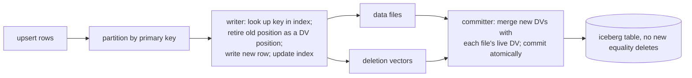

# V4 Flink sink: an upsert path without equality deletes

Status: draft for discussion.

## Problem

Iceberg v4 forbids writing new equality deletes. Equality deletes carried
over from a v2 or v3 ancestor are still readable, but a v4 commit may not add
one. Flink's upsert sink is the only writer that still depends on them: on
every upsert, it emits an equality delete for each key it cannot find in the
current writer's in-checkpoint map. On a v4 table that path has nowhere to
go.

Two guard PRs are open to stop the damage: #18993 makes the core library
refuse to add new equality deletes to a v4 table, and #18994 makes the Flink
sinks refuse to run in upsert mode against a v4 table. Together they prevent
incorrect v4 writes; they do not give Flink an upsert path. This proposal
describes one.

## Proposal

Keep the upsert decision in Flink, at write time, and emit deletion vectors
(DVs) directly.

For each table, the sink keeps a key index in Flink keyed state. The index
holds, for every primary key the sink has ever written, the current
location of that row: a data file and a row position inside it. On an
upsert for key K, the sink looks up K; if it is known, it retires the old
position by adding it to the DV of that data file, then writes the new row
and records its new location. A delete retires the position without a new
row. The commit output is data files plus one DV per touched file. Nothing
in the commit is an equality delete.

The index is populated on first use. On a cold start the sink walks the
branch head once and indexes every live row; on restart from a checkpoint
it reloads the saved state. When compaction has moved rows since the last
barrier, the sink applies the resulting file delta to the index before its
next commit, and the committer rebases any already-emitted DVs to the new
file locations.

## Scope of the first version

One thing at a time.

- The ordinary single-table sink only.
- V3 tables only. Once this ships on v3, the same writer is what can later
  target v4.
- Aligned checkpoints only. The sink refuses to start when unaligned
  checkpoints are enabled and explains why.
- Compaction runs inside the same Flink job. External compactors on these
  tables are not supported in v1.
- When Flink state is older than the table's current head, the sink fails
  fast on restore with a message that names the drifted snapshot and tells
  the user to restart without state.

## Out of scope for v1 (planned, later)

- Unaligned checkpoints.
- The dynamic, multi-table sink.
- External compactors sharing the same table.
- An option to rebuild the index from the table on a stale restore.
- A shared, cross-engine key lookup index on the table (the index spec work
  tracked under #18187), which would let other engines read the same index
  Flink maintains.
- Matching restored commits to a Flink job by the table UUID rather than by
  the sink's own identifiers.

## Correctness and failure behaviour

The design has been exercised against 31 crash and restore scenarios
covering normal failover, stale restores, cancel-and-restore, savepoint
rescale, external compaction interleavings, and snapshot expiry. Every
scenario either ends with the correct rows or fails loudly at restore with
a message that names the drifted snapshot. No scenario produced a silently
wrong table.

Two commit-level properties keep the writer safe under concurrency. Every
commit merges new DVs with each file's live DV at the current head, so two
writers touching the same file do not clobber each other's deletes; and a
commit that lost a race (typically against a compaction) is retried after
adjusting its view of the table. Starvation by faster-than-sink external
rewrites is why external compaction is out of scope for v1 -- running it
in the same job sidesteps the race.

## Cost

Measured at 10M keys on a laptop MiniCluster at parallelism 2. The index
costs about 14.7 bytes per key on disk. Update throughput is about 6x
slower than today's equality-delete writer (excluding the one-time index
build, about 11 s at 10M keys), in exchange for a full scan that is about
2x faster than reading through equality deletes. Faster reads are the
reason v4 forbade equality deletes in the first place.

## Open questions

1. Is per-job in-job compaction an acceptable constraint for v1, or do
   reviewers want a story for external compactors in the first version?
2. When this writer lands on v3 behind a flag, should the default be off,
   opt-in per table, or on by default?
3. Should we aim to converge this on the shared key lookup index now, or
   ship v1 with a private Flink-state index and migrate later?

## Plan: small PRs in order

1. Land the two guard PRs so v4 cannot be written incorrectly today
   (#18993, #18994).
2. Add a v3, single-table, aligned-checkpoint, in-job-compaction DV upsert
   writer behind a flag.
3. Allow the same writer on v4 and require it there.
4. Lift the aligned-checkpoint restriction.
5. Back the Flink-state index with the shared, table-level index once that
   spec work is ready.
6. Extend to the dynamic, multi-table sink.
